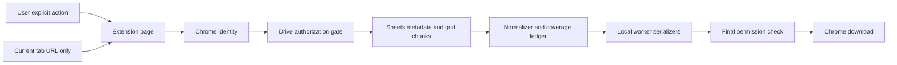

# Architecture proposal

Status: đề xuất để review; production acquisition bị chặn bởi G1. Các nguồn S1-S15 xem `feasibility-assessment.md`. Không có code implementation trong tài liệu này.

## A. So sánh phương án hợp lệ

| Tiêu chí | A: Drive permission gate + Sheets GridData + local writers | B: Drive native XLSX export + local parse/convert |
|---|---|---|
| Correctness | Chủ động ranges, coordinates, types, 3 modes | Tốt cho native workbook; formatted strings/formula cached values/visibility cần thêm validation; không đủ bằng chứng đáp ứng mọi Must |
| Policy | Gate explicit; API read success không là quyền export | Documented export endpoint + cùng gate; không bypass denial |
| Supportability | Public v3/v4 interfaces; field masks/chunks | Public endpoint; native conversion dependencies |
| Performance | Chia range; nhiều requests; memory có budget | Một export request nhưng 10 MB cap, parse cả file |
| Privacy | Local memory only | Local memory only |
| Permissions | spreadsheets.readonly + drive.metadata.readonly + identity email scope dự kiến | drive.readonly hoặc drive.file được grant; scope rộng hoặc cần picker |
| Maintenance | Normalizer và serializers rõ contract | Import XLSX rồi sanitize/convert; khó kiểm soát formula/display fidelity |

Chọn A có điều kiện vì đáp ứng selected ranges và các value modes tốt hơn. B là phương án khả thi cho **native export subset**, không là fallback khi A bị policy denial và không thay thế toàn bộ requirements nếu chưa duyệt scope change. Biến thể A dùng `values.batchGet` nhẹ hơn, nhưng thiếu rich cell/error metadata; chỉ cân nhắc sau khi adapter chứng minh cùng contract. Approved data feed do admin cung cấp là hướng vận hành riêng, không tự thêm backend vào MVP.

## B. Stack và runtime

- TypeScript strict, Vite build, UI vanilla TypeScript + semantic HTML/CSS: ít dependency, module nhỏ cho agent yếu hơn. Không cần React/state library.
- Chrome MV3: toolbar action mở/reuse extension page `export.html`; service worker chỉ nhận action/tab context. Không giữ data job trong popup/SW.
- Extension page sở hữu OAuth, network, job controller, Blob/download lifecycle. Dedicated Web Worker làm normalization/serialization nặng, không nhận token.
- ExcelJS browser document writer; fflate cho multi-tab CSV ZIP. Vitest cho pure modules; Playwright cho extension E2E; independent XLSX reader trong test tooling. Version pin/Node runtime chọn và ghi sau T04/T07, không đoán latest.
- Không remote script/CDN/eval; bundle dependencies/workers local. CSP `script-src 'self'`, worker-src self, connect-src chỉ Google endpoints cần thiết; final manifest được smoke-test.
- Chrome permissions đề xuất: `identity`, `activeTab`, `downloads`; host permissions `https://sheets.googleapis.com/*`, `https://www.googleapis.com/*`. Không tabs-wide, cookies, scripting, clipboard, webRequest, unlimitedStorage. Nếu cần thêm host/scope, sửa ADR qua review.
- OAuth candidate: `spreadsheets.readonly`, `drive.metadata.readonly`, `userinfo.email` (same-token account display). Verify userinfo endpoint/scopes tại T05. `drive.file` giảm file scope nhưng paste ID không tự grant; không tự thêm Picker remote scripts vào MV3.

## C. Data flow / trust boundaries



Tab URL, workbook title, sheet names, cell text, API errors đều untrusted. Parse URL allowlist; render textContent; filenames sanitized; never evaluate formulas/HTML. Token chỉ ở auth/network memory, không worker/message payload/log/export. UI/worker messages kiểm schema + jobId + generation; không external messaging. Chỉ controller gọi publish sau full coverage + final gate. Trạng thái từ worker không đủ cấp quyền download.

## D. Module ownership và contracts

```text
src/contracts/        domain.ts, ports.ts, errors.ts, messages.ts
src/auth/             chrome-identity.ts, account.ts
src/source/           identify.ts, a1.ts, drive-gate.ts, sheets.ts
src/domain/           scope.ts, chunks.ts, normalize.ts, visibility.ts, coverage.ts
src/jobs/             controller.ts, retry.ts, limits.ts, consistency.ts
src/export/           names.ts, json.ts, csv.ts, csv-package.ts, xlsx.ts
src/runtime/          service-worker.ts, export-worker.ts, download.ts
src/ui/               source-view.ts, scope-view.ts, job-view.ts, main.ts
tests/                fixtures/, unit/, integration/, e2e/, readers/, benchmarks/
docs/evidence/        spike reports, sanitized tenant results, release checklist
```

Contracts được T08 freeze trước các adapter. Tên dưới đây là normative proposal; thay đổi phải có reviewer, không để từng agent tự định nghĩa khác.

| Contract | Nội dung / invariants |
|---|---|
| SourceRef | spreadsheetId; optional highlightedSheetId; không network URL tùy ý |
| AccountContext | principalKey + displayEmail, memory only; account change invalidates jobs |
| Eligibility | discriminated status: permitted/restricted/login_required/admin_approval_required/missing_or_inaccessible/uncertain; reasonCode; checkedAt; principalKey; sourceId; evidenceRevision |
| WorkbookMeta | id/title/locale/timeZone; ordered sheets{id,title,index,type,hidden,rows,columns}; source version observation |
| Rect | sheetId,r0,c0,r1,c1; zero-based half-open; valid positive area within grid |
| ExportRequest | sourceId, principalKey, ordered sheetIds, one Rect per sheet, mode, format, visibility, limitsVersion; immutable after start |
| Cell | r,c absolute zero-based; kind string/number/boolean/error; value; optional formulaText, numberFormatType; never JS Date or executable formula object |
| NormalizedChunk | jobId, chunkId, Rect, sorted sparse cells, excluded dimension intervals, bytes; absence != unknown coverage |
| CoverageLedger | deterministic planned leaf rectangles, completed IDs; failed/retried/child split records; complete iff exact selected coverage incl. intentional exclusions |
| Artifact | bytes/Blob, MIME, filename, safe summary; kept private before final gate |
| ExportReport | versioned source/scope/mode/visibility/name mapping/timing/consistency/warnings/transform counts; no account metadata |

Ports: `AuthPort.signIn/getContext/getToken/signOut`; `PermissionPort.check(source,context,signal)`; `SheetsPort.getMetadata/readGrid(rect,signal)`; `WriterPort.begin/append/finalize/abort`; `DownloadPort.publish(artifact,signal)`; injected Clock/Random/Fetch for tests. `readGrid` requires controller-granted permitted context; actual token access stays network-side.

Domain freeze after T08a review: `src/contracts/domain.ts` is normative. Non-grid/unknown sheets may omit dimensions; validators must not invent zero bounds. `evidenceRevision` identifies local evidence/rule format, not an immutable Google ACL revision. Report metadata explicitly includes selected output format and visibility. Exclusions use compact zero-based half-open dimension intervals. Port/message contracts remain T08b/T08c work.

## E. Scope, coordinates và visibility

1. Default chọn tất cả tabs không hidden, full **allocated grid** từng tab: `[0,rowCount) x [0,columnCount)`. Hiện chính xác bounds và cảnh báo không phải used range. Hidden tabs opt-in. `gid` chỉ highlight.
2. Initial UI hỗ trợ một rectangle/tab: single cell, A1:B20, whole row/column ranges resolve bằng grid bounds; optional quoted sheet prefix phải trùng selected sheet. Reject named ranges, unions, reverse/out-of-bounds, cross-sheet ranges. Một rectangle đáp ứng Must; disjoint multi-range là later enhancement.
3. Chia 2D chunks phủ toàn bộ selected rectangle, không dừng sau blank streak. Ban đầu 20,000 cell positions/chunk; response lớn thì split rectangle deterministically, coverage parent chỉ hoàn thành khi toàn bộ children pass. Không bỏ distant cells.
4. Visibility mặc định đề xuất `api-visible`: loại hiddenByUser/hiddenByFilter rows/columns và hidden tabs, **giữ khoảng trống vị trí**, không compact. UI ghi rõ “theo metadata API; không tái tạo personal filter view”. Khi không có đủ visibility evidence, disable chế độ này và yêu cầu user chọn include-all hoặc cancel, không tự đổi.
5. GridData offsets cộng vào row/column index; field bị omit theo documented default chỉ được diễn giải sau fixture verification. Missing/blank cells không emit sparse record; explicit empty string emit string `""` nếu API phân biệt được. Không hứa phân biệt cleared cell với never-set blank nếu API không cung cấp.
6. Merged ranges không được expand/fill-down; chỉ giá trị anchor mà API trả. Ghi warning nếu selection cắt merge. Unsupported sheet type được báo trước job, không âm thầm skip.
7. XLSX giữ absolute coordinates; selected C5:D6 vẫn ở C5:D6. CSV là rectangle-relative rows/columns, report nêu origin C5, excluded positions vẫn empty fields. JSON luôn absolute. Empty full tab vẫn có scope và sheet entry.

## F. Value normalization

| Mode | Quy tắc |
|---|---|
| formatted | `formattedValue` thành string; không tự format theo máy user; missing representation bất thường -> explicit unsupported/error |
| raw | `effectiveValue` number/bool/string/error; date/time giữ serial number + numberFormatType + workbook timezone/locale; không cast Date |
| formula_text | userEnteredValue.formulaValue -> inert string; nonformula cells dùng effective typed value; UI giải thích mixed types |

Errors giữ `kind:error`, code/message nguồn đã sanitize; JSON tagged error, CSV/XLSX inert error text. Formatted/formula modes là projection theo request, không đồng thời export mọi raw/formula field nếu user không chọn. Text “00123”, whitespace và Unicode giữ nguyên. Không header inference, dedupe, numeric parsing hay formula evaluation.

## G. JSON v1 và report

`ExportReport` chứa metadata; `JsonExportDocument` thêm `sheets` bắt buộc. Report v1 có schemaVersion, source, export{startedAt,producedAt,mode,format,visibility,complete,consistency,warnings}, selectedScopes, sheetOrder, limitsVersion, nameMappings và exclusions. JSON file chỉ có complete=true, format=json, và không được báo known source change. Thời gian ISO 8601 UTC; complete chỉ nghĩa đủ selected scope, không phải atomic snapshot. File lỗi/partial không được publish.

```json
{
  "schemaVersion": "1.0",
  "source": {"id":"fixture-id","title":"Demo","locale":"en_US","timeZone":"Asia/Ho_Chi_Minh"},
  "export": {"startedAt":"2026-10-30T02:00:00Z","producedAt":"2026-10-30T02:00:04Z","mode":"raw","format":"json","visibility":"include_all","complete":true,"consistency":"not_atomic_no_change_detected","warnings":[]},
  "selectedScopes": [{"sheetId":0,"rect":{"sheetId":0,"r0":0,"c0":0,"r1":90000,"c1":26}}],
  "sheetOrder": [0],
  "limitsVersion": "v1-proposed",
  "nameMappings": [{"sheetId":0,"originalTitle":"Data","exportedName":"Data"}],
  "exclusions": [],
  "sheets": [{"id":0,"title":"Data","index":0,"scope":{"sheetId":0,"r0":0,"c0":0,"r1":90000,"c1":26},"visibility":{"mode":"include_all","excludedRows":[],"excludedColumns":[]},"cells":[{"r":0,"c":0,"kind":"string","value":"00123"},{"r":89999,"c":25,"kind":"number","value":42}]}]
}
```

Cells sorted r,c; unique coordinates within scope; nonfinite numbers reject; error cells use value `{code,message}`. JSON Schema draft 2020-12 ở `src/contracts/export.schema.json` sẽ được tạo T09, additionalProperties=false tại boundaries; future incompatible change tăng major. Warnings là `{code,message,sheetId?}`, không raw HTTP bodies.

Shared report dùng selectedScopes cho declared scope; chỉ successful coverage mới thành output. Optional sourceObservations.before/after lưu observedAt/version/modifiedTime, không gọi Drive version là pinned revision. CSV transform metadata dùng policy=apostrophe_prefix_v1, totalTransformedCells và bySheet counts. Multi CSV ZIP chứa `manifest.json` report. XLSX dùng companion `<base>.metadata.json` (2 files, không thêm worksheet làm sai AC-01). Single CSV dùng UI summary và nút tải metadata riêng; CSV vẫn single `.csv` theo FR-09. Báo từng download status; không claim cả bộ complete nếu secondary download bị chặn. JSON tích hợp report fields tương ứng; source observations không chứa principal.

## H. Format rules

- CSV UTF-8 BOM, comma, CRLF record endings; quote mọi field, double embedded quotes; giữ embedded CR/LF nguyên bản; không header tự sinh. Blank rectangle có đúng dimensions (empty fields). Single tab một CSV; multi tab ZIP có một CSV/tab + manifest; zero tabs invalid.
- CSV safety: source strings/formula text bắt đầu `= + - @`, tab/CR/LF, hoặc whitespace/control prefix trước những ký tự đó được prefix apostrophe trước escaping. True numeric negative giữ numeric text. Ghi count/warning, JSON là exact-value alternative. Không hứa universal behavior cho mọi spreadsheet importer; phải test Excel/LibreOffice. T04 chặn release nếu supported readers execute payload.
- XLSX gán typed scalar; **không bao giờ** tạo formula/sharedFormula/hyperlink object từ nguồn. Strings luôn string kể cả `=...`. Check dimensions, text length, XML-invalid characters và numeric precision risk; không tự truncate. Không biểu diễn chính xác được -> reject/explicit JSON alternative. Formula execution không có trong initial release.
- Names: worksheet replace `[]:*?/\\`, trim invalid edge apostrophes, max 31 UTF-16-safe characters, nonempty fallback `Sheet_<id>`; case-insensitive collision suffix `~2`, re-truncate suffix-aware; test reserved names với writer. File basename sanitize path/control/Windows reserved names, case-fold collision suffix stable sheetId. Report lưu original -> output mapping. Không merge tabs vì tên giống nhau.

## I. Job state, resource bounds và cleanup

State machine: idle -> authenticating -> checking_permission -> discovering -> ready -> planning -> reading -> serializing -> final_check -> downloading -> completed. Terminal branches: restricted/uncertain/failed/cancelled/interrupted. Every async continuation checks jobId+generation+AbortSignal; permission error beats stale worker success. `completed` đòi browser download success, không chỉ createObjectURL.

Retry: chỉ network/408/429/5xx và rate-limit reasons đã allowlist; tối đa 4 attempts/request, jittered exponential delay 1/2/4s, honor Retry-After đến remaining job budget; token expiry refresh một lần rồi recheck permission. Timeout fetch 60s, job wall-time 10 phút (đề xuất); không retry policy/404/unknown403. Cancel abort fetch/timer, terminate worker nếu cần, clear references. Serialize progress indeterminate nếu library không có count.

Đề xuất initial limits (chưa benchmark): 10M selected positions/job, 250k emitted cells, 64 MiB cumulative decoded grid data, 64 MiB total uncompressed artifacts, 128 MiB downloaded bytes tổng; 1 in-flight Sheets read, 45 Sheets reads/min/user local pacing, 20k positions/chunk. Project quota chia sẻ không thể đảm bảo bởi client limiter; handle 429. UI warn từ 1M positions/ước tính >60s. Byte limits vượt thì abort trước publish; không chuyển scope tự động. Peak memory target <=512 MiB trong benchmark, không xem browser heap estimate là enforcement đáng tin cậy.

Không IndexedDB/data persistence trong v1. Memory gồm chunks/writer/output có budget; worker transfer buffers khi phù hợp. Đóng/reload/discard page làm job interrupted, không auto-resume, user start lại bằng permission check mới; UI ghi rõ giữ tab mở. SW suspension không dừng page job. Blob URL chỉ tạo sau final check; revoke khi download terminal; clear buffers on cancel/error/sign-out/completion/pagehide. Crash không thể chạy cleanup JS nhưng không có app-owned persistent dataset để recover/leak; không hứa secure erase OS/browser memory.

Consistency: đọc Drive version/modifiedTime và sheet dimensions trước/sau; khác -> discard staged output, báo source_changed, đề nghị chạy lại. Không đổi không chứng minh snapshot (volatile formulas/external data). Metadata luôn ghi non-atomic limitation. Không publish output khi detected change trong v1.
